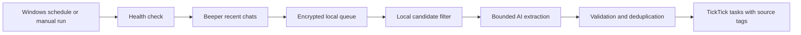

# TaskCapture

A Windows task-capture pipeline that reads recent WhatsApp and Slack conversations through Beeper, extracts assignments using a ChatGPT subscription through Codex CLI, and maintains a TickTick list with source labels and chat names.



- Includes groups and direct chats active in the last seven days, within the scope you authorize.
- Detects configured name variants, mentions, replies, commitments, English, Urdu and Roman Urdu requests. It focuses on assignments to the configured user.
- Adds `[W]`, `[S]` or `[W and S]` plus short chat labels. Related requests can merge into one task with full source metadata.
- Uses one nullable output slot per message; durable message IDs are restored locally. Invalid deadlines become undated `[Review]` tasks.
- Skips extraction when there are no candidates. Each pass sends at most 40 targets with bounded context; backlogs take multiple passes.
- Retains delivery reservations and reconciles ambiguous writes before retrying. It does not automatically delete or complete tasks.

## Requirements

Windows 11 with Windows PowerShell 5.1, Node.js 22.16+ (Node 24 recommended), Beeper Desktop with its local API enabled, Codex CLI signed into an eligible ChatGPT account, and TickTick OAuth through its official MCP server. Subscription usage and model access depend on your account.

The TickTick bridge currently depends on an **experimental Codex app-server protocol**. Health checks fail before collection if required tools, authentication, model availability or destination identity are unavailable. CLI updates may require compatibility work. Offline tests verify software behavior; they do not guarantee perfect AI task interpretation.

## Start here

```powershell
.\Initialize-Config.ps1
.\Test-Offline.ps1
```

Configuration copies are created only when missing. Edit the ignored `config/*.json` files for your own name, aliases, task list and source permissions. Checked-in `*.example.json` files contain placeholders and keep live capture disabled.

Follow [Setup](docs/SETUP.md) for authentication, deployment and scheduling. See [Architecture](docs/ARCHITECTURE.md), [Troubleshooting](docs/TROUBLESHOOTING.md), [Security](SECURITY.md) and [Developer handoff](HANDOFF.md).

## Run and inspect

From an installed runtime directory:

```powershell
# Read-only queue inspection: no chat collection, model or TickTick call
.\Run-Capture.ps1

# Live collection and delivery, after configuration and activation
.\Run-Capture.ps1 -Live
```

Live mode opens a named progress window. Minimize it while it works; closing it interrupts the run. The default schedule is 20:00 and 23:00 in Pakistan time, with missed-start catch-up. The PC must be awake and signed in, Beeper running, and internet available. The desktop chat app is not required to remain open.

## Source and private state

This folder is the source checkout for future Git commits and pushes. The installed runtime lives under `%USERPROFILE%\TaskCaptureState\runtime`; encrypted operational data lives in `%USERPROFILE%\TaskCaptureState`. An absolute `TASKCAPTURE_STATE` override is supported.

Credentials, OAuth stores, chat data, databases, logs, personal configuration and local historical notes are excluded from the repository. The `private/` folder is local-only. Do not copy private state into the repository or post message bodies in issues.
